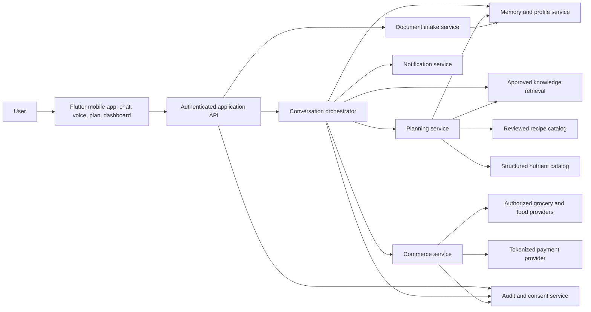
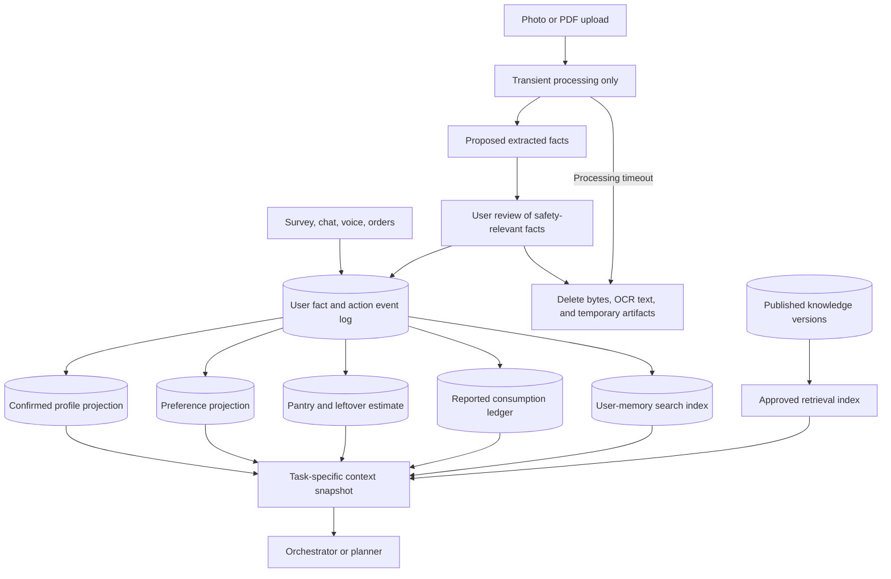
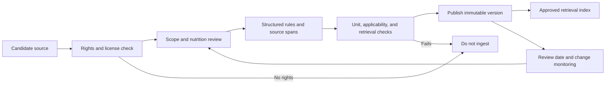
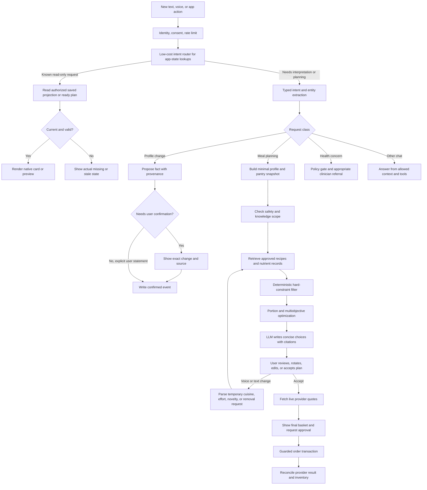
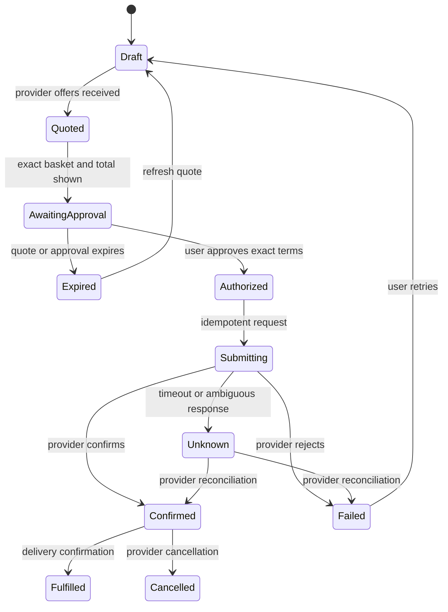

# Personal Food Agent — Agent System Design

Status: Agent architecture baseline  
Date: 21 October 2026  
Companion: [Product requirements](PRD.md)

## Implementation baseline (22 October 2026)

- Launch market: India, English, INR; Cloudflare selected for hosting.
- Backend: modular TypeScript API deployed on Cloudflare Workers with D1 (SQLite) behind repository interfaces. Keep one deployable application initially; split services only when operational needs justify it.
- Sign-in: Google OAuth 2.0 is the active identity option. ChatGPT/OpenAI identity sign-in remains disabled in the app and API while access is invite-only. OAuth proves identity; Valora issues and maintains its own app session and authorization.
- Phase one: wire Flutter to persistent backend APIs for profile, preferences, and memory; build core PRD functionality including planning, pantry/meal records, insights, and notification settings/flows. Defer AI provider calls, document extraction, and Swiggy/provider integration to phase two.
- Swiggy target UX: when added in phase two, keep discovery, cart review, and checkout inside Valora using Swiggy MCP-rendered data and delegated per-user authorization, subject to production approval and terms. Do not assume basket handoff to the Swiggy app; UPI may launch an external payment app or QR flow.
- Knowledge source administration: admins may manage sources; retain source-rights checks, structured validation, immutable versions, publication audit, and rollback.
- Age scope: product audience requested as all ages, one person per account. No guardian/family feature is planned. Personalized planning for minors and special populations is not clinically validated; safeguards and launch legal requirements must be decided before public release.
- Data retention/privacy policy is provisional for this build and must be resolved before launch.

### Cloudflare deployment shape

Use a Cloudflare Worker as the authenticated API boundary, with Cloudflare Hyperdrive connecting to managed PostgreSQL. Use Cloudflare Queues for retryable background work and scheduled Workers for notification timing. Store only non-sensitive public/static knowledge artifacts in object storage; apply the database's access controls and encryption model to user records. Keep provider/model secrets in Cloudflare secrets. Select the PostgreSQL host/region after checking India-region availability, latency, backup/restore, and contractual data handling. Do not put health profile or memory payloads in Workers KV or cache. This is a proposed deployment shape, subject to confirming current Cloudflare product and regional constraints before implementation.

The phase-one backend has no live model, document, or Swiggy dependency. Define typed interfaces and disabled/unavailable states for those integrations; do not return sample data as live results.

## 1. Architecture decision

Use **one conversation orchestrator** backed by specialized services. The orchestrator interprets requests, decides which approved tools to call, and explains results. Services own facts, constraints, calculations, and transactions. No independent agent may alter a health constraint, publish knowledge, or spend money.

This avoids competing memories and unclear authority in a multi-agent system. If specialist models are added later, they remain stateless workers returning typed proposals to the same orchestrator. Parallel calls are limited to independent read-only work, such as fetching prices from different providers.

The agent has four authority levels:

| Level | Examples | Authority |
| --- | --- | --- |
| Observe | Read profile, search approved guidance, fetch prices | Allowed after relevant user consent and access checks |
| Propose | Extract a fact, draft a meal plan, suggest a preference | Requires validation; does not change confirmed state |
| Commit user state | Save a confirmed allergy, correct inventory, log an eaten meal | Requires an explicit user action or a clearly authorized source event |
| External action | Submit an order or payment | Requires a fresh approval for exact terms and a guarded transaction |

## 2. System context



### Component ownership

| Component | Owns | Must not do |
| --- | --- | --- |
| Mobile app | Presentation, user edits, consent, approval, local capture | Decide safety or infer purchase success |
| API/auth | Personal identity, consent, rate limits | Expose another user's data to the model |
| Orchestrator | Intent routing, dialogue, tool sequence, explanation | Act as a system of record or bypass service gates |
| Memory/profile | Event history, fact provenance, corrections, derived views | Convert model inference to confirmed fact silently |
| Document intake | Temporary file validation, OCR, structured fact extraction, immediate purge | Retain uploaded files, page images, full OCR text, or file embeddings; interpret a medical report as a diagnosis |
| Knowledge service | Published versions, scoped retrieval, citations | Retrieve unreviewed web pages as medical/nutrition guidance |
| Planner | Candidate generation, constraint filtering, portions, objective ranking | Use prose generation for arithmetic or safety decisions |
| Commerce | Provider adapters, price snapshots, basket, approval, order state | Accept an LLM statement as purchase approval |
| Notification service | Scheduling, quiet hours, prompt budget, delivery | Send arbitrary model-generated pushes without policy checks |
| Audit/consent | Grants, revocations, action trace, deletion workflow | Store unnecessary sensitive raw prompts indefinitely |

### Mobile framework decision

The production mobile client will use **Flutter** for iOS and Android. This replaces the earlier React Native/Expo assumption. Keep the client limited to presentation, local secure credentials, notification and OS integrations, and an optional on-device model adapter; authenticated APIs remain the boundary for persistent user data and server-owned actions.

For on-device Gemma evaluation, use Google's documented LiteRT-LM Flutter route through `flutter_gemma`. Google currently describes the Flutter integration as community-maintained, so it is a candidate integration rather than a guaranteed stable platform contract. Isolate it behind a small `OnDeviceModel` interface and capability-check device/model support. Do not make local inference necessary for onboarding, reading saved data, safety filtering, planning, or ordering. Validate package maintenance, model licensing/distribution, iOS and Android behavior, device memory, latency, battery, and app-store packaging before relying on it in production. If the package cannot meet those gates, the Flutter app still functions with its server-side AI path; do not add a bespoke native bridge as an assumed fallback.

Flutter handles UI and platform access; it does not change the backend, database, knowledge-base, consent, or purchase-approval boundaries below. OS-specific behavior such as push notifications, secure storage, background execution, microphone access, and notification actions must be verified on both platforms.

## 3. Data architecture

### 3.1 Storage layers



The event log captures facts and actions. Projections represent current state and can be rebuilt after a correction or policy change. “Append-only” describes the normal write path; personal payloads remain subject to deletion and retention rules. Deletion removes or cryptographically erases the payload, records a minimal tombstone where required, and rebuilds derived views. A semantic index may index retained fact records, but it is never the source of truth for allergies, orders, or approvals. The model receives a **task-specific snapshot**, not the user's full history. The initial data model has one user and one personal inventory; family linking is reserved for a later version.

### 3.2 Fact record

Every user-memory item has at least:

```text
fact_id, user_id, type, normalized_value, unit
source_type, source_event_id, optional_page_or_region, observed_at, recorded_at
status: proposed | confirmed | rejected | superseded | expired
confidence, sensitivity, effective_from, effective_until
confirmed_by, consent_scope, schema_version
```

The value is typed. For example, `allergy: peanut` is different from `dislike: peanut`, `inventory_has: dry rice 1 kg` is different from `consumed: cooked rice 100 g`, and `reported_condition` is different from `diagnosed_condition`. Inventory and consumption are linked by lot or prepared-meal ID so eating affects the remaining stock. A user-entered condition is recorded as **user reported**; the app does not promote it to a diagnosis.

Confidence does not override status. An inference with high statistical confidence is still an inference. Critical conflicts, such as “peanut allergy” versus a later peanut-containing order, trigger clarification and keep the protective constraint until resolved. A newer statement does not automatically erase a safety fact.

### 3.3 Core entities and events

| Entity | Key fields | Representative events |
| --- | --- | --- |
| User | Locale, time zone, budget period, notification settings | `UserConfigured`, `BudgetChanged` |
| Health context | User-reported conditions, allergies, restrictions, medications relevant to food planning, source | `HealthFactProposed`, `HealthFactConfirmed`, `HealthFactCorrected` |
| Preference | Cuisine, ingredient, spice, prep effort, source, strength | `PreferenceStated`, `PreferenceSuggested`, `PreferenceConfirmed` |
| Goal | User wording, category, review date, scope | `GoalSet`, `GoalChanged` |
| Food item | Canonical food ID, aliases, form, units, nutrient source/version | `FoodMapped`, `FoodMappingCorrected` |
| Recipe | Ingredients, edible yield, servings, allergens, method, provenance/version | `RecipePublished`, `RecipeRetired` |
| Inventory lot | Food ID, raw/cooked state, received quantity, unit, estimated remaining, expiry, confidence | `ItemReceived`, `IngredientAllocated`, `InventoryConfirmed`, `ItemDiscarded` |
| Prepared-meal lot | Recipe/version, source inventory lots, edible yield, portions remaining, expiry | `MealPrepared`, `PreparedPortionEaten`, `MealDiscarded` |
| Meal plan | Date, recipe/version, portions, substitutions, rationale, review constraints | `PlanProposed`, `PlanRotated`, `PlanEdited`, `PlanAccepted` |
| Intake record | Meal, actual food, amount/range, linked inventory or prepared-meal lot, reporter, coverage | `MealReported`, `PortionCorrected` |
| Price quote | Provider, SKU, pack size, availability, fees, timestamp, expiry | `QuoteReceived`, `QuoteExpired` |
| Order | Basket snapshot, approval ID, provider ID, state, receipt | `OrderSubmitted`, `OrderConfirmed`, `OrderFailed`, `OrderReconciled` |
| Consent | Purpose, data categories, destination, grant/revoke time | `ConsentGranted`, `ConsentRevoked` |

Uploads are streamed through protected processing memory with a short bounded lifetime; no server file or durable temporary object is created. OCR/transcription and extraction produce typed fact proposals. The user reviews safety-relevant proposals while the upload is available; the service then purges file bytes, page images, full OCR text, embeddings, and processing copies from memory. If the review is abandoned, a short processing deadline triggers the same purge; unconfirmed safety facts remain inactive. Only fact records and minimal provenance such as source type and page number may persist. Logs and model providers must not retain uploaded content; processing integrations must support this requirement or cannot be used. Because the source file is gone, later review shows the extracted fact and its recorded provenance, not the original page. If the user disputes it, they can correct the fact or upload the source again. Deletion of a fact propagates to projections, search indexes, and caches; minimal transaction records needed for legal/accounting purposes follow an explicit retention policy.

### 3.4 Derived profile and invalidation

The system has separate projections for **health context** (confirmed user-reported constraints and relevant document facts), **food behavior** (reported meals with coverage), and **planning preferences**. A computed food-pattern summary may describe observed variety or approximate nutrient totals over a stated period; it is never stored as a diagnosis, deficiency, or clinical “health score.” Each computed value records its input event range, source-data versions, coverage, calculation version, and timestamp.

A new allergy, corrected portion, changed personal schedule, retired recipe, or new knowledge version invalidates affected cached plans. The planner recomputes before the plan is next shown or ordered. An already approved basket is invalidated if a newly confirmed safety constraint affects it.

### 3.5 Pantry and consumption accounting

Use a stock ledger with explicit transfers. An order creates an expected incoming item; confirmed delivery or the user's receipt confirmation creates an ingredient lot. A manually added item also creates a lot. Preparing a recipe deducts raw ingredient quantities once and creates a prepared-meal lot with edible yield and portions. Eating a prepared portion reduces that prepared-meal lot and creates an intake record; it does **not** deduct the ingredients again. Eating an ingredient directly creates an intake record linked to and deducted from its ingredient lot. A meal prepared elsewhere creates intake without touching personal inventory. Recipe yield and raw-to-cooked conversion come from validated data; “100 g cooked rice” must not be subtracted as “100 g dry rice.” If a meal is reported eaten before preparation was logged, the agent asks whether it came from inventory, a prior leftover, or elsewhere before changing stock.

For each lot, `remaining = additions - transfers_out - direct_consumption - discarded`, with uncertainty attached to estimated amounts. A correction reverses or adjusts the linked movement and recomputes inventory and intake projections, avoiding duplicate deductions. Pack size is converted to edible quantity only when a validated mapping exists. Perishability and expiry are tracked independently from nutrient estimates.

`ordered`, `delivered`, `prepared`, and `eaten` are separate states. An order cannot create an intake event. If the user says “I ate half,” store an estimated portion and mark its coverage; do not fill in the rest of the day with assumptions. Dashboard nutrient totals are shown only for reported meals and labeled “partial” when coverage is incomplete.

## 4. Curated knowledge system

### 4.1 Source classes

| Class | Examples | Permitted use |
| --- | --- | --- |
| Dietary guidance | Approved public-health guidance and clinician-reviewed policy | General food-planning constraints and explanations within documented population scope |
| Nutrient composition | Licensed nutrient database, validated brand labels | Quantitative food calculations with units and version |
| Recipe catalog | In-house or licensed tested recipes | Ingredients, yields, preparation, substitutions |
| Provider catalog | Merchant SKUs, menus, prices, availability | Shopping facts only; never clinical authority |
| User material | Reports, photos, chat | Personal evidence only after consent and confirmation where needed |

The publication workflow is: source acquisition and rights check → human nutrition/clinical scope review → structured fact/rule extraction → unit and applicability validation → test queries → signed version publication → scheduled review or retirement. Published structured versions are immutable. Each rule records an external source reference, effective date, jurisdiction, target population, exceptions, reviewer, approval date, and licensing status. Source PDFs/images and full extracted text are not retained. The retrieval index contains only published structured facts/rules.

WHO describes dietary balance through adequacy, balance, moderation, and diversity, while noting individual and cultural variation. This is suitable as general framing, not as a substitute for a clinical plan. [WHO healthy diet](https://www.who.int/en/news-room/fact-sheets/detail/healthy-diet) USDA FoodData Central offers structured nutrient data through an API and states its data are CC0; regional dishes still require suitable local data and careful mapping. [USDA API guide](https://fdc.nal.usda.gov/api-guide/) For an India launch, the ICMR-NIN dietary-guidelines PDF states that product electronic storage or reproduction needs prior written permission; obtain rights before ingesting it. [ICMR-NIN guidelines](https://www.nin.res.in/dietaryguidelines/pdfjs/locale/DGI24thJune2024fin.pdf)

### 4.2 Retrieval policy

Retrieval filters by `published`, jurisdiction, age/population, topic, effective date, and license before ranking. The response includes exact record IDs and versions. The response validator rejects citations outside the retrieved set and numeric nutrition claims that do not match the calculation service. When no applicable source or nutrient mapping exists, the planner marks the value unknown and asks for clarification or produces a less specific food suggestion. Open web search, provider descriptions, and user documents cannot promote themselves into approved guidance.



## 5. Request processing



The read-only route covers pantry, saved allergies and food rules, budget and cooking limits, and an already computed plan. It fetches structured state with authorization and version checks, then renders a native widget without an LLM. A ready plan is shown only while its profile, safety facts, recipe, and other required versions remain valid. A question asking why can first use stored plan rationale. If the request needs new reasoning, computation, or a proposed data change, the mobile UI switches from workspace cards to a conversation view. No mutation is committed merely by routing into conversation; the appropriate validation and confirmation gate still applies. Ambiguous intent also enters the agent path rather than returning an unrelated widget. This routing keeps routine lookups fast and inexpensive while making the source of each answer clear.

### 5.1 Intent and memory update

The extraction model returns a validated structure: `intent`, `entities`, `candidate_facts`, `uncertainties`, and `requested_action`. A schema validator rejects malformed or unsupported types. Explicit user statements can update low-risk preferences directly, while allergies, health context extracted from uploads, and ambiguous changes require a confirmation card. “I don’t want pasta tonight” changes this plan; it is not automatically a permanent dislike. “I never eat pasta” can become a stated preference.

At the review stage, `rotate_plan` accepts typed or transcribed voice commands for a selected meal or day; the default scope is the currently displayed day's proposed meals. “Something Italian” applies a cuisine constraint, “simple and quick” applies an effort/time constraint, and “something different” increases novelty relative to recent plans. These are **current-review constraints** unless the user explicitly saves them as preferences. Rotation preserves hard restrictions and firm budget limits, reuses inventory when feasible, and returns a new plan version with an explanation of what changed. Any earlier quote or basket approval is invalidated if the changed plan affects its contents.

### 5.2 Health policy gate

The gate checks whether the user reports a new condition, acute injury, medication issue, serious symptom, special population, or a clinician-directed diet. The agent can acknowledge the update and ask whether it should be saved. It may continue with general food logistics where safe, but does not infer treatment, nutrient deficiencies, supplement needs, or condition-specific targets without a separately approved clinical workflow. If suitability is uncertain, it avoids personalized claims and directs the user to a qualified professional. This gate runs before planning and again before presenting the result.

### 5.3 Plan generation and ranking

Candidate generation retrieves recipes matching geography, cuisine, equipment, and time for one user. The deterministic filter removes candidates violating confirmed allergies, explicit exclusions, incompatible ingredients, or other hard constraints. Unknown allergen/ingredient data is not treated as safe. With no feasible candidate, the system explains the missing information or offers a manual option.

For feasible candidates, compute portions and a rolling 3–7 day shopping plan using structured nutrient data, recipe yields, pantry estimates, pack sizes, expiry, and current budget. A user-stated maximum spend is a hard constraint; a general wish to spend less is a ranking preference. Rank using a transparent set of soft objectives: dietary variety, alignment with user goals, preferences, prep burden, total cost, likely food waste, and delivery convenience. The user may prioritize objectives; the product does not silently trade away a hard constraint. Prefer presenting a few distinct options over hiding a single opaque “optimal” answer.

Nutrition is an **estimate** from mapped food records and reported portions. Missing micronutrients, uncertain restaurant recipes, and incomplete intake are labeled unknown. No model-generated macro number enters the database without deterministic recomputation. The product evaluates trends in observed behavior, not causal effects on a user's health.

### 5.4 Commerce and approval state machine



The approval record binds `user_id`, provider, canonical basket/SKUs, quantities, allowed substitutions, delivery address/window, maximum total, currency, quote ID, and expiry. The first version requires an authenticated action on the exact basket review card; a generic “yes” in chat is insufficient. The commerce service verifies the approval at submission time. Any material change returns to approval. Use a provider idempotency key and reconcile unknown outcomes before retrying, so a timeout cannot create duplicate orders. The model may request `prepare_basket`; only the commerce service may call `submit_order` after verifying the approval record.

For Swiggy MCP, Valora's target surface is in-app discovery, cart rendering, final bill review, and checkout, using MCP tool responses and a delegated Swiggy authorization per Valora user. Swiggy production onboarding, exact redirect URI allowlisting, permitted surfaces, and agreement are prerequisites. Keep returned Swiggy PII to the active task, omit request/response bodies from routine logs, and do not send Swiggy-originated data to cloud inference outside India without the required agreement and transfer controls. Swiggy documents UPI app-intent/QR payment and MCP order placement; this does not establish a populated-cart handoff to the Swiggy app. Treat order-placement timeouts as unknown and reconcile through order lookup before retrying because MCP placement is not idempotent. Any external UPI app launch is limited to payment completion, not the shopping/checkout experience.

MCP can be used as an internal adapter interface if desired, but provider access is through narrowly scoped server-side tools. The model does not receive a general payment, browser, or arbitrary HTTP tool. A prepared-food option follows the same quote and approval path.

### 5.5 Tool contracts and execution rules

All tools accept an authenticated actor, tenant scope, request ID, and schema version. Read tools return source IDs and freshness timestamps; write tools return event IDs or a typed failure. The orchestrator can retry read calls. Write calls need idempotency keys and explicit retry policy.

| Tool | Main input | Output | Gate |
| --- | --- | --- | --- |
| `get_context` | User, task, allowed data categories | Minimal fact snapshot and versions | Consent and tenant check |
| `propose_fact` | Typed value, source span, confidence | Proposal ID | Schema and provenance check |
| `confirm_fact` | Proposal ID, explicit user action | New fact event and profile version | User identity and conflict check |
| `search_knowledge` | Topic, locale, population, purpose | Published record IDs and citations | Publication and license filters |
| `find_recipes` | Constraints, cuisine, inventory | Versioned recipe candidates | Allergen/ingredient completeness |
| `plan_meals` | Profile version, recipe IDs, horizon, budget | Feasible plans, calculations, uncertainty | Deterministic constraint engine |
| `rotate_plan` | Plan version, selected meal/day, temporary review constraint from voice/text | New plan version and change summary | Reapply hard constraints; invalidate affected quote |
| `get_quotes` | Canonical basket, location, providers | Timestamped offers and full totals | Provider capability and freshness |
| `prepare_basket` | Chosen offer, substitutions policy | Exact basket review and expiry | Price and inventory recheck |
| `submit_order` | Basket ID, approval ID, idempotency key | Confirmed, failed, or unknown state | Bound user approval and authorization |
| `record_intake` | Food/meal, portion or range, reporter | Intake event and coverage | Explicit report or approved source |
| `schedule_prompt` | Purpose, proposed time, sensitivity | Scheduled, deferred, or suppressed | Quiet hours and prompt budget |

A plan result carries the profile version, recipe versions, nutrient-source versions, knowledge version, calculation version, and price snapshot IDs. The client discards or refreshes a result if a safety fact changes. The order service independently rechecks the active approval and exact terms; it does not trust an orchestrator-produced flag.

## 6. Model placement and cost

| Task | Preferred method | Escalation |
| --- | --- | --- |
| Simple intent and preference extraction | Rules or small model with typed output | Cloud model for ambiguity |
| OCR and transcription | Device/OS service when available | Approved cloud service with consent |
| Nutrition math, portion conversion, safety filter | Deterministic code and data | Human/data review for missing mappings |
| Plan search and ranking | Search plus optimization service | No LLM arithmetic fallback |
| User-facing explanation | Small capable model with retrieved evidence | Larger model for complex dialogue |
| Medical report reading | Transient OCR and extracted fact proposals for immediate user review | Approved human/clinical workflow; no autonomous diagnosis or file retention |

On-device models are optional acceleration for short extraction, transcription, summarization, and privacy-preserving capture. Their availability varies by device and operating system, so the product must capability-check and degrade gracefully. Apple documents on-device Foundation Models as suitable for tasks such as summarization and extraction, with more limited reasoning than server models. Android documents Gemini Nano through AICore and ML Kit for on-device tasks. [Apple Foundation Models](https://developer.apple.com/documentation/FoundationModels), [Android Gemini Nano](https://developer.android.com/ai/gemini-nano)

Cost controls: task-specific context, structured memory instead of replaying chat, short retrieval results, cache by plan/profile/knowledge version, batch read-only price requests, model routing by task complexity, request budgets, and measurement of cost per successful plan and active user. Neither a locally hosted model nor fine-tuning replaces the persistent database or the curated knowledge workflow.

## 7. Proactive interaction

The scheduler chooses a potential prompt from upcoming plan time, expiring pantry items, unresolved inventory uncertainty, changed schedule, or an unanswered high-value profile question. A policy service applies quiet hours, daily/weekly limits, recent dismissals, and a “will this answer change a decision?” threshold. The orchestrator writes a short notification from approved facts; the user can act, snooze, or dismiss. Notification content avoids exposing sensitive health details on a lock screen by default.

In-app voice is the baseline. Audio is transcribed for the current request and then discarded; only extracted user-approved facts or requested actions enter memory. A notification may open directly into a voice-ready chat. Direct voice replies from a notification are a platform-dependent enhancement and are not required for the core loop.

## 8. Security, privacy, and operational controls

- **User isolation:** Every retrieval and tool call is scoped by authenticated user. A later family feature must link existing accounts through explicit invitations and narrowly scoped sharing; it must never merge health profiles by default.
- **Consent:** Separate grants for health fact extraction, cloud processing, provider connections, and notifications. Revocation stops future access and initiates the defined deletion workflow.
- **Sensitive storage:** Protect upload bytes and OCR text only during transient processing, then purge them. Encrypt retained fact/event data in transit and at rest; restrict staff access; keep sensitive content out of routine logs and analytics.
- **Prompt injection:** Treat reports, recipe text, menus, provider responses, and retrieved content as untrusted data. Use typed tool responses, instruction/data separation, output validation, and tool allowlists. Retrieval alone does not prevent prompt injection. [OWASP LLM01](https://genai.owasp.org/llmrisk/llm01-prompt-injection/)
- **Purchase protection:** Server-side authorization, exact approval binding, idempotency, provider reconciliation, and full transaction audit.
- **Knowledge change control:** Reviewer roles, publish approval, signed immutable versions, rollback, and retirement of outdated guidance.
- **Observability:** Track extraction corrections, unsupported claims, missing nutrient mappings, filter failures, price staleness, order ambiguity, model cost, and knowledge version distribution. Store enough trace IDs to explain a decision without retaining entire sensitive prompts by default.
- **Failure behavior:** If the KB lacks applicable guidance, report that limit. If a price feed is stale, refresh before approval. If an order outcome is unknown, reconcile before retrying. If a profile fact conflicts, ask and keep the safer constraint pending resolution.

## 9. Evaluation and release gates

Evaluate each layer independently with a reviewed scenario set: conflicting allergies, ambiguous document extraction, incomplete meal logs, raw-to-cooked ingredient conversion, prepared leftovers, direct ingredient consumption, inventory corrections, package-size leftovers, perishable inventory, missing nutrient values, merchant substitutions, changed prices, quote expiry, provider timeouts, and prompt injection inside a PDF or menu. Include voice/text plan rotation and “remove without reason.”

Minimum release gates are: no purchase without a valid bound approval; no confirmed-allergen escape in candidate filtering; no unsourced nutrition claim; no inferred diagnosis/supplement recommendation; no order-to-intake conversion; and reliable reconciliation of unknown purchase outcomes. These are design gates; they have not been executed or validated by this document.

## 10. Worked example

User: “I injured my ankle. I will not cook tomorrow. I have 350 to spend and might still have rice.”

1. The orchestrator extracts `temporary_no_cooking`, `budget_limit=350`, `inventory_uncertain=rice`, and a proposed `injury_reported` fact. It asks whether to save the injury context; it does not diagnose or prescribe food for the injury.
2. Memory returns the user's confirmed allergies and preferences, existing orders, and the uncertain rice estimate. The agent asks about rice only if it affects the options.
3. The planner filters out unsafe or unsuitable dishes, searches prepared-food and low-effort options, and estimates portions. It does not use an unknown restaurant ingredient list to claim allergen safety.
4. Commerce fetches live, available offers. The app shows several options with delivered totals and any ingredient uncertainty.
5. The user picks one and approves the exact basket. The commerce service submits with an idempotency key, records the provider response, and updates order history.
6. The app later asks whether the meal was eaten and in what portion. Only that answer updates the intake ledger. The user's next plan can reflect confirmed leftovers and expressed preferences.

## 11. Open integration contracts

Before Swiggy implementation, obtain staging and production access, confirm permitted in-app rendering and checkout surfaces, register exact OAuth redirect URIs, and verify the selected Food/Instamart tools and payment methods. Each provider adapter declares support for search, price quote, in-app cart/checkout, direct order, substitution controls, payment, status, cancellation, and receipt access. Missing capabilities disable the corresponding action rather than being simulated. Regional knowledge rights, clinical review ownership, and retention requirements also need explicit owners. These are external inputs, not model decisions.
